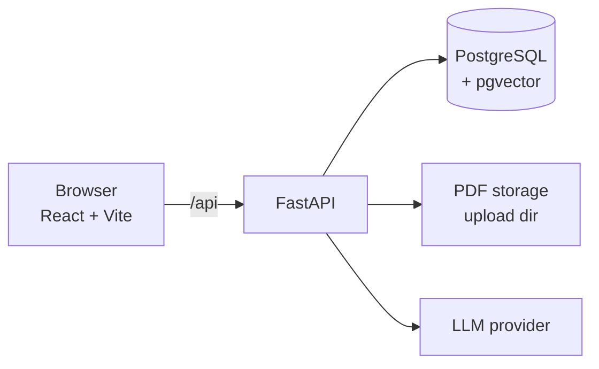

# MemoZip

**An AI study companion.** Upload a course PDF and MemoZip turns it into study material: quizzes that adapt to what you got wrong, summaries, and a chat that answers from your own course and shows the pages it used. It tracks which topics you have mastered and which still need review.

- **Frontend:** React, TypeScript, Vite, Tailwind CSS
- **Backend:** FastAPI, SQLAlchemy, Pydantic
- **Database:** PostgreSQL 15+ with pgvector, pg_trgm and citext

---

## Features

| Area | What you can do |
|---|---|
| **Upload** | Add a PDF (up to 30 MiB). The app shows four processing steps (reading, structure, key concepts, preparing study material), extracts topics and lets you retry a failed document. |
| **Quizzes** | Generate a quiz from a course: choose the difficulty, number of questions and question types (multiple choice, true or false, short answer). Quizzes are graded on the server and every attempt is kept. |
| **Results** | Score, per-topic performance, an AI analysis, the questions you missed with the correct answer and an explanation, and a "Review weak topics" quiz built from your weakest topics. |
| **Attempt history** | Every quiz keeps all its attempts, with a score chart across retakes. |
| **Summaries** | Overview, key points and numbered concept sections. Regenerate, rename, save or delete. |
| **AI Chat** | Ask questions across all your courses or one course. Answers cite the course, pages and section. Conversations are saved and can be reopened. |
| **Library and folders** | One library for documents, saved quizzes and saved summaries, with search and type filters. Group items into folders (deleting a folder never deletes its content). |
| **Progress** | Quizzes completed, average score and topics mastered on the home page. |
| **Themes** | Three complete palettes: Tokyo Night (default), Neon Amber and Frost. Switch instantly from the navbar; the choice is remembered. |

---

## Architecture



- In development the Vite server forwards `/api` to the backend, so the browser sees a single origin (no CORS setup, cookies just work).
- The backend stores uploaded files on disk (`UPLOAD_DIR`), extracts text per page, splits it into chunks, and uses an LLM to extract topics and to generate quizzes, summaries and chat answers.
- Everything is scoped to the signed-in user.

---

## Repository layout

```
memozip/                 Frontend (React + Vite)
  src/
    components/          Reusable UI (Navbar, ThemeSwitcher, Logo, cards, modals…)
    layouts/             AppLayout, AuthLayout, ProtectedRoute
    pages/               One file per screen
    hooks/               useQuery, useAuth, useTheme
    services/api/        The only code that talks to the backend (+ mappers.ts)
    theme/               Theme list, favicon
    styles/              index.css: the three themes as CSS variables
  public/brand/          Logo files for each theme

backend/                     Backend (FastAPI)
  app/
    api/                   Routers: documents, folders, library, conversations, chat, stats
    services/              PDF, chunking, topics, quizzes, attempts, summaries
    schemas/               Pydantic request/response models
    models/                SQLAlchemy models (one file per table)
    core/                  Settings and database session

database/
  schema.sql             PostgreSQL schema (18 tables, 3 views)
  schema.puml            Diagram for PlantUML
  DATABASE.md            Model overview and design decisions
```

---

## Getting started

### Prerequisites

- Node.js 18 or newer
- Python 3.11 or newer
- PostgreSQL 15 or newer with the `vector`, `pg_trgm` and `citext` extensions available
- An API key for the LLM provider the backend is configured to use

### 1. Database

```bash
createdb memozip
psql memozip -f database/schema.sql
```

`schema.sql` creates the extensions, enum types, tables, indexes and views. Run it on an empty database. If you manage the schema with Alembic, use it as the reference for the first migration.

### 2. Backend

#### Configure environment variables

From the project root, navigate to the backend directory:

```bash
cd backend
```

Create a local environment file from the example:

```bash
cp app/.env.example app/.env
```

On Windows PowerShell, you can use:

```powershell
Copy-Item app/.env.example app/.env
```

Open `app/.env` and configure the following variables:

| Variable | Description |
|---|---|
| `DATABASE_URL` | PostgreSQL connection URL for the MemoZip database |
| `SECRET_KEY` | Secret used to sign authentication tokens |
| `GEMINI_API_KEY` | API key used to access Google's Gemini API |
| `APP_NAME` | Application name |
| `ENVIRONMENT` | Application environment |
| `ALGORITHM` | Algorithm used for JWT authentication |
| `ACCESS_TOKEN_EXPIRE_MINUTES` | Access token lifetime in minutes |
| `REFRESH_TOKEN_EXPIRE_DAYS` | Refresh token lifetime in days |

Use your own PostgreSQL credentials and Gemini API key. Never commit your actual `.env` file or expose secret values in the repository.

#### Install dependencies

MemoZip uses `uv` to manage Python dependencies:

```bash
uv sync
```

#### Run database migrations

Apply the database migrations:

```bash
uv run alembic upgrade head
```

Ensure PostgreSQL is running and the database specified in `DATABASE_URL` exists before executing this command.

#### Start the API server

```bash
uv run uvicorn app.main:app --reload
```

The API is available at `http://127.0.0.1:8000`.

Interactive API documentation is available at `http://127.0.0.1:8000/docs`, and a database check at `GET /api/health/db`.

### 3. Frontend

```bash
cd memozip
npm install
npm run dev                     # http://localhost:5173
```

Open the app, create an account on the register page and upload a PDF. To build for production: `npm run build`.

---

## How the main flows work

**Upload.** `POST /api/documents/upload` validates the file (PDF only, magic bytes checked, 30 MiB limit), stores it and extracts text page by page. The frontend polls `GET /api/documents/{id}` while the status is `processing` and shows the step from `processing_step`. A failed document can be retried with `POST /api/documents/{id}/retry`.

**Quiz.** `POST /api/documents/{id}/quizzes` generates the quiz. When the student opens it, `POST .../attempts/start` creates an attempt; `POST .../attempts` submits the answers, which are graded on the server and stored with a per-topic score snapshot. "Review weak topics" generates a new quiz limited to the topics scored below 60.

**Chat.** The first message creates a conversation (`POST /api/conversations`, `document_id` null means all courses), then `POST /api/conversations/{id}/messages` retrieves passages, asks the LLM and returns the answer with its sources. An answer with no relevant passage has no sources, which is how the UI shows "I couldn't find that in your courses".

**Mastery.** A topic is *mastered* at 80% or more and *weak* below 60%. The home page counts topics mastered from each quiz's latest attempt.

---

## API overview

Interactive reference: `/docs`. All routes are under `/api`.

| Group | Endpoints |
|---|---|
| **Auth** | `POST /auth/register`, `POST /auth/login`, `GET /auth/me`, `POST /auth/refresh`, `POST /auth/logout` |
| **Documents** | `GET /documents`, `GET`, `PATCH`, `DELETE /documents/{id}`, `POST /documents/upload`, `POST /documents/{id}/retry`, `POST /documents/{id}/topics` |
| **Quizzes** | `POST /documents/{id}/quizzes`, `GET /documents/quizzes/saved`, `GET`, `PATCH`, `DELETE /documents/quizzes/{id}`, `PATCH /documents/quizzes/{id}/save` |
| **Attempts** | `POST /documents/quizzes/{id}/attempts/start`, `POST` and `GET /documents/quizzes/{id}/attempts`, `GET /documents/quizzes/attempts/{attemptId}` |
| **Summaries** | `POST` and `GET /documents/{id}/summary`, `PATCH`, `DELETE /documents/summaries/{id}`, `PATCH /documents/summaries/{id}/save`, `POST /documents/summaries/{id}/regenerate` |
| **Folders** | `GET`, `POST /folders`, `GET`, `PATCH`, `DELETE /folders/{id}` |
| **Library** | `GET /library`, `GET /library/items`, `GET /library/documents`, `GET /library/folders/{id}`, `GET /library/summaries/{id}`, `PATCH /library/quizzes/{id}/folder`, `PATCH /library/summaries/{id}/folder` |
| **Chat** | `GET`, `POST /conversations`, `GET`, `PATCH`, `DELETE /conversations/{id}`, `POST /conversations/{id}/messages`, `GET /chat/suggestions` |
| **Stats** | `GET /stats` |
| **Health** | `GET /`, `GET /health/db` |

---

## Data model

Eighteen tables, grouped by purpose. The full schema is in `database/schema.sql`, and `database/DATABASE.md` explains the choices.

| Group | Tables |
|---|---|
| Accounts | `users`, `refresh_tokens` |
| Organization | `folders` |
| Course content | `documents`, `topics`, `document_chunks` (text, pages and embeddings for retrieval) |
| Quizzes | `quizzes`, `quiz_focus_topics`, `questions`, `quiz_attempts`, `attempt_answers`, `attempt_topic_scores` |
| Summaries | `summaries`, `summary_concepts` |
| AI Chat | `conversations`, `messages`, `message_sources` |
| Background work | `jobs` |

Rules worth knowing:

- Deleting a document deletes everything generated from it (topics, chunks, quizzes, attempts, summaries and chats about it).
- Deleting a folder only unfiles its content.
- Every retake is a new attempt row; questions never change after generation.
- Links between a user's items use composite foreign keys, so an item can never point at another user's document or folder.

---

## Known limitations

- There is no endpoint to update the account yet: quiz defaults (difficulty and question count) are stored in the browser, and changing name or email is not available.
- Quiz and summary generation are synchronous, so the request waits for the LLM. If this becomes slow, return a job id and poll `jobs`.
- The frontend's upload check (`MAX_FILE_MB` in `src/utils/validation.ts`) must match the backend limit (30 MiB).

### Not in the MVP

A topic mastery model with study recommendations, spaced repetition and flashcards. The schema leaves room for them: questions are stable rows with their own ids, and per-topic scores are stored for every attempt.