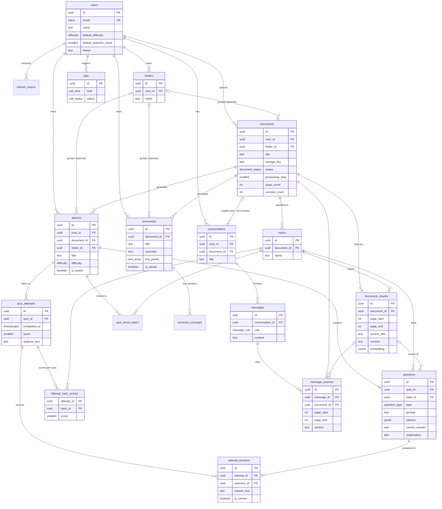

# MemoZip: database model

PostgreSQL 15+ with the `pgvector`, `pg_trgm` and `citext` extensions. The full DDL is in [`schema.sql`](./schema.sql). This model covers the MVP and matches the frontend's types, pages and API layer one-to-one.

> `schema.sql` was written without access to a PostgreSQL server, so it has **not been executed yet**. Run it on an empty database first (`psql -f schema.sql`) and fix anything it reports. Expect small corrections at most.

## Entity relationship diagram



## How the frontend maps to tables

| Frontend type / screen | Database |
|---|---|
| `User`, Settings page | `users` (name, email, default difficulty, default question count, theme) |
| `Document`, `Topic`, Upload steps | `documents` (with `status` and `processing_step` 0–4 for the progress screen), `topics` |
| Course Q&A, quiz and summary generation (RAG) | `document_chunks` (pages, section, embedding) |
| `Quiz`, quiz setup screen | `quizzes` (difficulty, requested count, question types, `is_saved`), `quiz_focus_topics` for "Review weak topics" |
| `Question` | `questions` |
| `QuizAttempt`, `AnswerRecord` | `quiz_attempts`, `attempt_answers` |
| `TopicScore`, "Your performance" | `attempt_topic_scores` |
| "AI analysis" paragraph | `quiz_attempts.analysis_text` |
| `Summary`, `SummaryConcept` | `summaries`, `summary_concepts` |
| `Folder` and item counts | `folders`, view `folder_item_counts` |
| `Resource` (Library, Recent resources) | view `library_items` |
| `Stats` ("Your progress") | view `user_stats` |
| AI Chat, `Conversation`, `ChatMessage`, `SourceRef` | `conversations`, `messages`, `message_sources` |
| Generation latency, polling | `jobs` |

## Design decisions worth knowing

**Every retake is a new attempt.** `quiz_attempts` is append-only. The current result is simply the latest row with `completed_at` set, and the attempt history chart reads all of them.

**Questions are a snapshot of one quiz.** A question belongs to exactly one quiz and does not change after generation, so old attempts always show the right question, options and explanation. "Review weak topics" creates a new quiz (with `quiz_focus_topics`) instead of editing the old one.

**Per-topic scores are stored, not recomputed.** `attempt_topic_scores` holds the percentage per topic for each attempt. It keeps history stable and makes "topics mastered" a cheap query. The app thresholds are *strong ≥ 80* and *weak < 60*; the `user_stats` view uses 80.

**Generated, saved, and in the Library are different things.** A generated quiz or summary exists immediately so it can be taken or read; `is_saved = true` is what puts it in the Library and in folder counts.

**Deleting.** Deleting a document cascades to topics, chunks, quizzes, attempts, summaries, chats about it and citations (the frontend already warns about this). Deleting a folder sets `folder_id` to null on its contents (PostgreSQL 15 `ON DELETE SET NULL (folder_id)`). The API must also delete the uploaded file from object storage when a document is deleted. There is no soft delete in the MVP, which keeps privacy simple.

**Tenant safety in the schema.** Rows carry `user_id`, and links use composite foreign keys such as `(folder_id, user_id) → folders(id, user_id)`. A quiz can never point at another user's document or folder, even if the API has a bug. One rule is left to the API: a question's topic must belong to the quiz's document.

**AI Chat scope.** `conversations.document_id` is `NULL` for "All my courses". A chat tied to a document is deleted with it instead of silently becoming an all-courses chat. The existing per-course Ask page uses the same tables.

**Citations are copied.** `message_sources` stores pages and section directly (plus an optional `chunk_id`), so a citation survives if a document is re-processed. An answer with no relevant passage has no rows, which is how the UI shows the "I couldn't find that" case.

**Questions use `jsonb` for options.** Options are small and immutable, so a separate table would add joins for nothing. A CHECK constraint guarantees the shape for each question type and that the correct answer is one of the options.

**Jobs.** Document processing, quiz generation and summary generation are slow and asynchronous with a real LLM. `jobs` lets the frontend poll, and records model and token counts so you can track cost per user.

## Decisions you still need to make

1. **Embedding size.** `vector(1536)` is a placeholder. Set it to your embedding model's dimension before creating the table (HNSW supports up to 2000).
2. **Login method.** The schema assumes email and password with cookie sessions (`refresh_tokens`). If you use OAuth or an auth provider, `password_hash` and `refresh_tokens` change.
3. **File storage.** `storage_key` assumes S3-compatible storage or a disk path; the database never stores the PDF.
4. **Language.** If courses can be in several languages, the full-text index on chunks (`'simple'` configuration) may need a per-document language column later.
5. **Migrations.** Use Alembic with SQLAlchemy models generated from this schema; `schema.sql` is the reference for the first migration.

## Not in the MVP (and how this model leaves room)

Per your requirements, these are future work, so there are no tables for them yet:

- **Topic mastery model and recommendations:** add a `topic_mastery(user_id, topic_id, score, updated_at)` table fed from `attempt_topic_scores`.
- **Spaced repetition:** add `review_schedule(user_id, question_id, due_at, interval, ease)`. This is why questions are stable rows with their own ids.
- **Flashcards:** add `flashcards` and `flashcard_reviews`, generated from `document_chunks` the same way questions are.

## Handy queries

```sql
-- Library, newest first, with search (uses the trigram indexes on titles)
SELECT * FROM library_items
WHERE user_id = $1 AND ($2::resource_type IS NULL OR type = $2)
ORDER BY date DESC;

-- Attempt history for one quiz (chart + list)
SELECT id, completed_at, score, correct_count, total_count
FROM quiz_attempts
WHERE quiz_id = $1 AND completed_at IS NOT NULL
ORDER BY completed_at DESC;

-- Weak topics for a course, from each quiz's latest attempt
SELECT t.id, t.name, round(avg(ts.score)) AS mastery
FROM (SELECT DISTINCT ON (quiz_id) id FROM quiz_attempts
      WHERE user_id = $1 AND completed_at IS NOT NULL
      ORDER BY quiz_id, completed_at DESC) latest
JOIN attempt_topic_scores ts ON ts.attempt_id = latest.id
JOIN topics t ON t.id = ts.topic_id
WHERE t.document_id = $2
GROUP BY t.id, t.name
HAVING avg(ts.score) < 60
ORDER BY mastery;

-- RAG retrieval for one course (cosine distance; add the tsv column for hybrid search)
SELECT id, page_start, page_end, section_title, content
FROM document_chunks
WHERE document_id = $1
ORDER BY embedding <=> $2
LIMIT 6;
```
